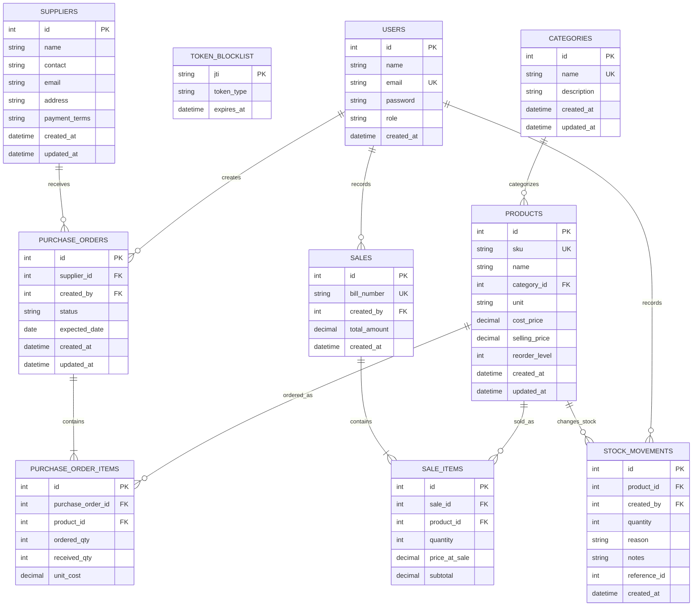

# Retail Inventory data model

This ER diagram reflects the SQLAlchemy models in `backend/src/backend/models`.
Products, suppliers, purchase orders, sales, and inventory events are stored as
relational records. Stock on hand is derived by summing
`stock_movements.quantity` per product; there is no editable
quantity-on-hand field.



`STOCK_MOVEMENTS.reference_id` is a polymorphic reference to the originating
purchase order or sale; it intentionally has no single foreign-key constraint.
Opening stock and manual adjustments may not have a parent transaction
reference. Token blocklist rows are keyed by JWT ID, record token type and
expiry, and support access/refresh token revocation.

## Relationships and operational rules

- Each product belongs to a category and can have many purchase-order lines,
  sale lines, and stock movements.
- Each purchase order belongs to a supplier and creator and contains one or
  more purchase-order items. Item rows store ordered quantity, received
  quantity, and unit cost.
- Each sale belongs to its creator and contains one or more sale items.
  Sale-item rows retain the price and subtotal captured at the time of sale.
- Users create purchase orders, sales, and stock movements. API permissions
  further limit which roles can access these records.
- `stock_movements.quantity` is signed: purchases and returns are positive,
  sales are negative, and adjustments can be positive or negative.
- Database checks prohibit zero movements, invalid movement reasons, and
  purchase/sale/return quantities with the wrong sign.
- Purchase-order status is constrained to `draft`, `approved`,
  `partially_received`, `received`, or `cancelled`.
- Product SKU, category name, user email, and sale bill number are unique.

## Stock calculation

For each product:

```text
on_hand = SUM(stock_movements.quantity)
```

Sale and receipt API operations write their parent transaction details and
corresponding stock movements together. This movement ledger is the source for
stock displays, reorder checks, valuation, and ledger-balance reporting.
