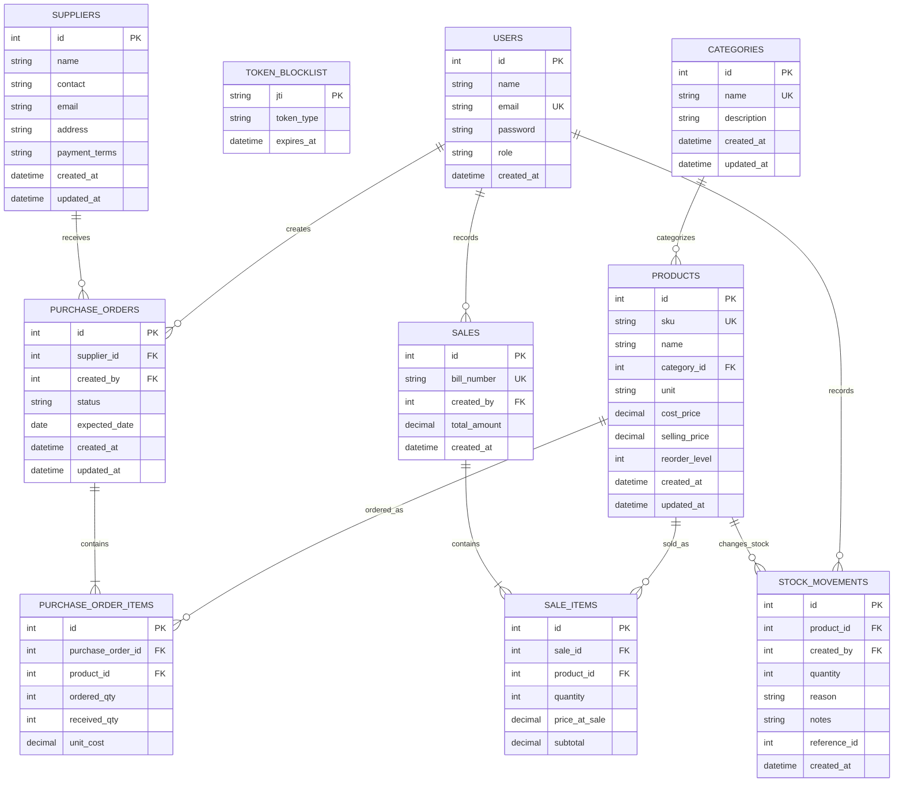

# Retail Inventory data model

This ER diagram reflects the SQLAlchemy models in `backend/src/backend/models`.
Stock on hand is derived by summing `stock_movements.quantity` per product;
there is no editable quantity-on-hand field.

`STOCK_MOVEMENTS.reference_id` is a polymorphic reference to the originating
purchase order or sale; it intentionally has no single foreign-key constraint.
Token blocklist rows are keyed by JWT ID and expire with the token.
