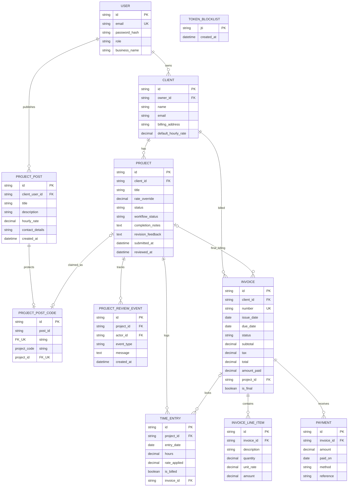

# Entity relationship diagram

`TIME_ENTRY.invoice_id` and `is_billed` capture the unbilled-to-billed transition. MongoDB collections persist the records and token blocklist; UUID IDs preserve the frontend API contract.

`PROJECT_POST` is a discovery notice separate from the billable `PROJECT` entity. It is owned by the posting client account and is converted only after a freelancer submits the client-issued UUID code. Raw codes are returned only to the owning client at creation or regeneration, and a successful claim links the post to exactly one project.

`PROJECT.workflow_status` tracks submission, revision, approval, and closure independently from `INVOICE.status`. A final invoice is unique per project; the partial unique index allows ordinary invoices to keep a null project ID. `PROJECT_POST.hourly_rate` is nullable only to preserve legacy posts created before the rate field existed.
